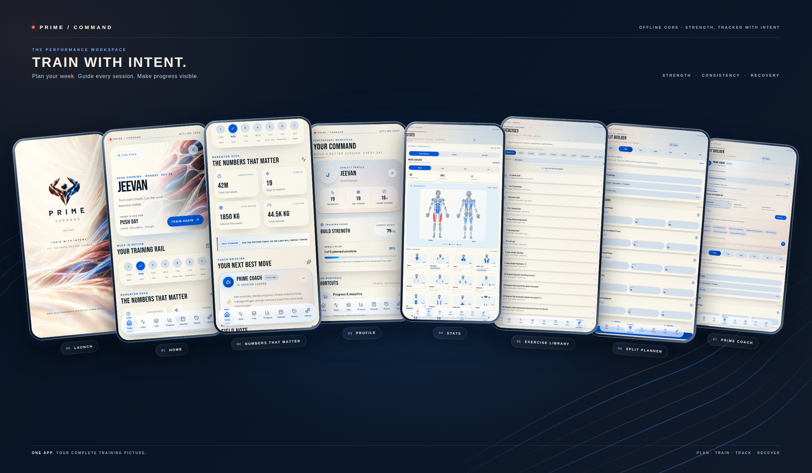
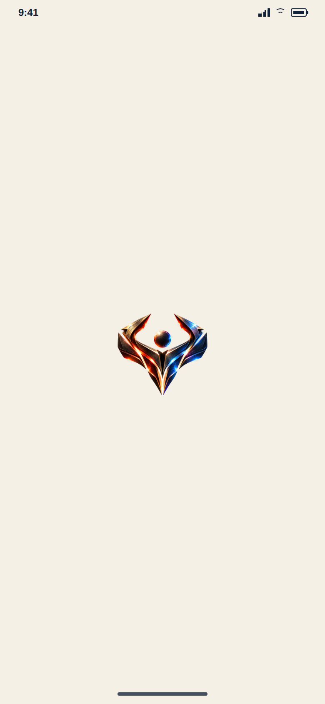
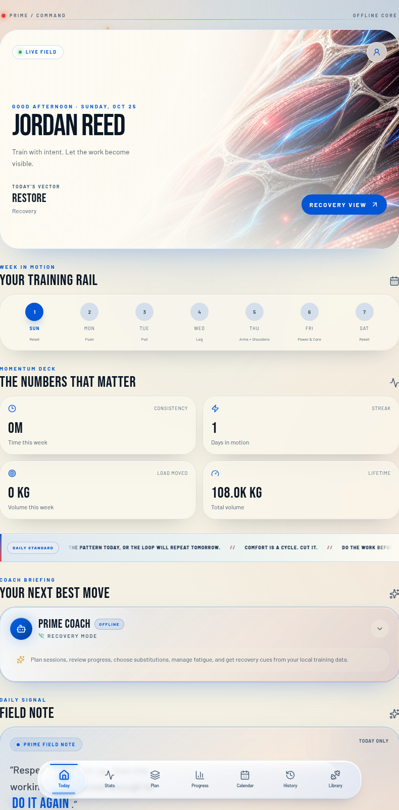
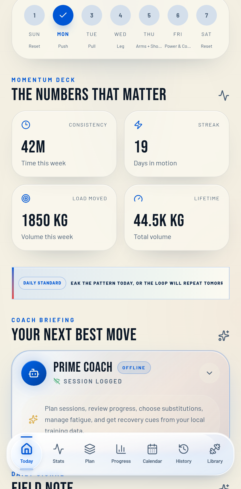
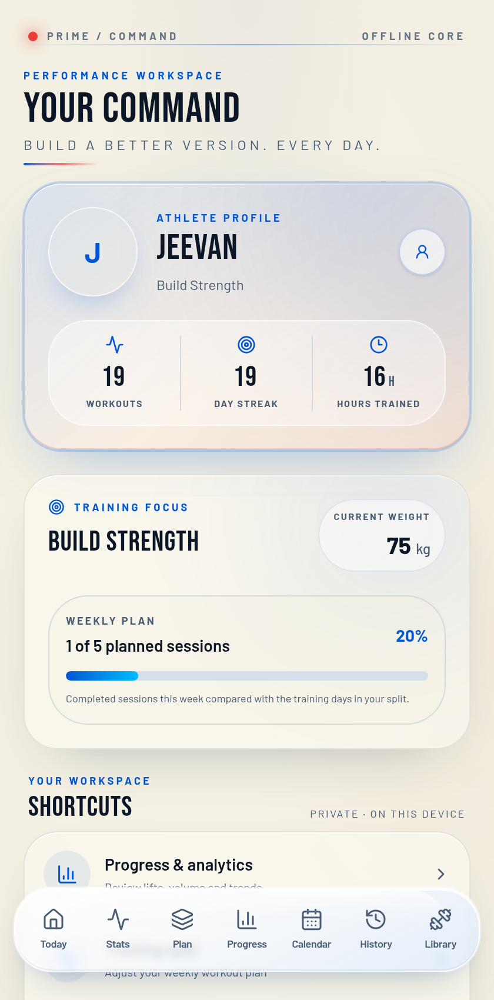
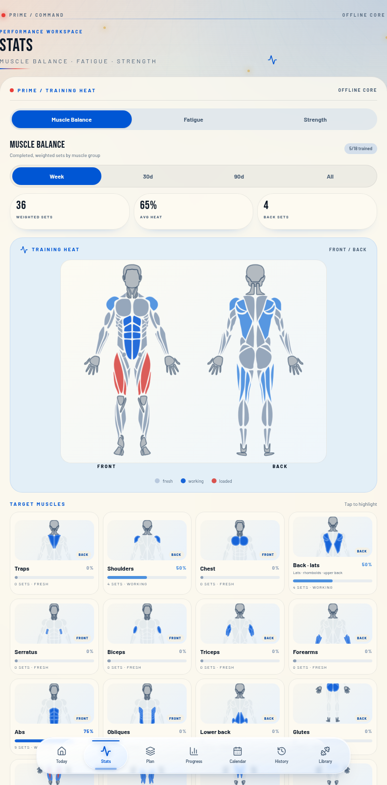
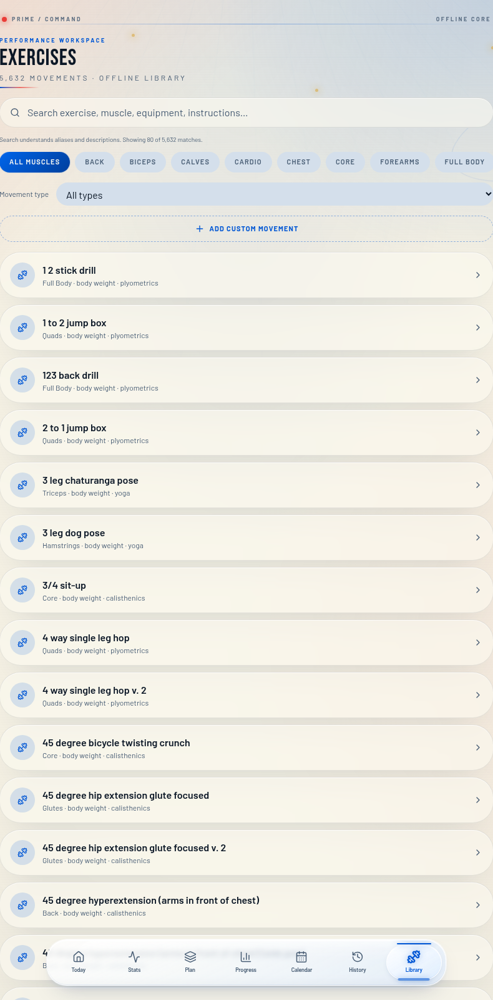
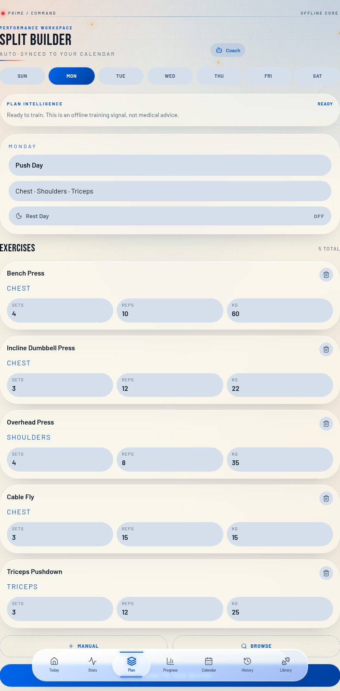
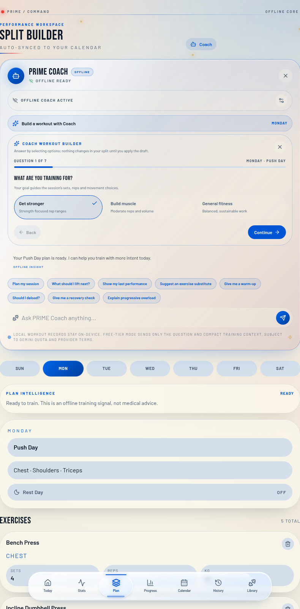
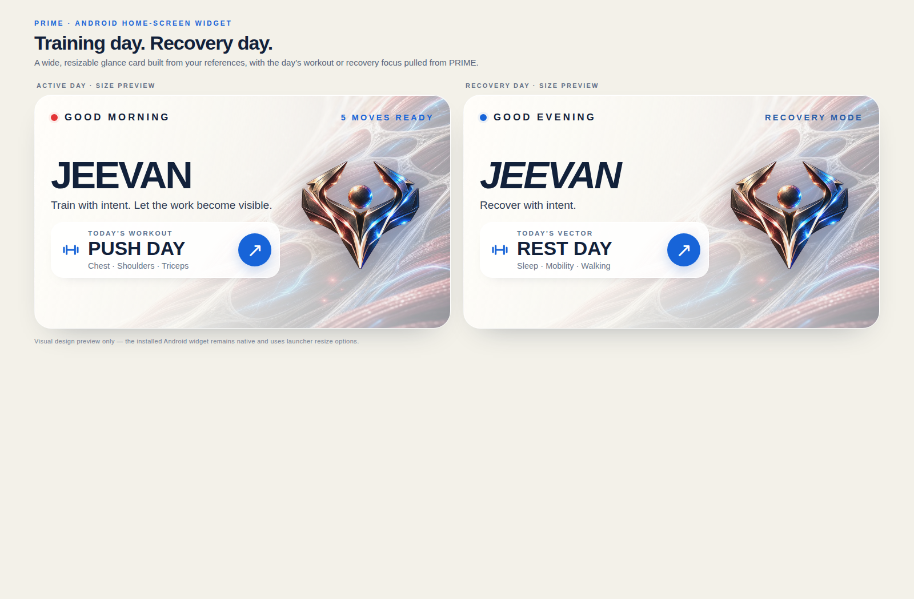

# PRIME

### Offline-first strength training for Android and the web

PRIME is a local-first workout companion for planning weekly training, guiding and recording sessions, exploring exercises, and reviewing progress. The responsive React app can run in a browser or be packaged as a native Android app with Capacitor. Core workout and profile features work offline; an optional online Coach mode is separate and user-configured.

[Open the live browser demo](https://jeevansaibotla.github.io/PRIME-WORKOUT-TRACKER/) · [Download the latest Android APK](https://github.com/jeevansaibotla/PRIME-WORKOUT-TRACKER/releases/latest) · [GitHub repository](https://github.com/jeevansaibotla/PRIME-WORKOUT-TRACKER)

See the [GitHub publishing guide](docs/GITHUB_PUBLISHING.md) to enable the demo and automate signed APK releases.

> **Application ID:** `com.ironpride.prime` · **Version:** `1.0.2` · **Target SDK:** 36
> Screenshots use synthetic sample workout data for documentation. Sample athlete data is not bundled into the app's default profile.

## Screenshots

The overview links to the full-resolution montage. The individual screens below are shown larger for easier inspection.

<p align="center">
  <a href="docs/screenshots/prime-app-overview.png">
    
  </a>
</p>

### Full-size app screens

<p align="center">
  <a href="docs/screenshots/splash-preview.png"></a>
  <a href="docs/screenshots/android-native-launch-preview.png"></a>
</p>
<p align="center"><sub>The Android native launch image is a static theme preview, not a device capture.</sub></p>
<p align="center">
  <a href="docs/screenshots/home.png"></a>
  <a href="docs/screenshots/numbers.png"></a>
</p>
<p align="center">
  <a href="docs/screenshots/profile.png"></a>
  <a href="docs/screenshots/stats.png"></a>
</p>
<p align="center">
  <a href="docs/screenshots/exercises.png"></a>
  <a href="docs/screenshots/plan.png"></a>
</p>
<p align="center">
  <a href="docs/screenshots/coach-intake.png"></a>
</p>

### Android home-screen widget

The native, resizable widget presents the scheduled workout on training days and a recovery-focused card on rest days. Tap the preview for the full-size two-state mockup.

<p align="center">
  <a href="docs/screenshots/prime-widget-preview.png"></a>
</p>

## Features

### Home and training

- Home dashboard with the **Week in Motion** training rail, today's planned session or recovery state, training-time and volume summaries, lifetime volume, motivational field notes, and quick access to PRIME Coach.
- Days-in-motion streak respects scheduled rest days: recovery days do not reset the streak, while a missed planned training day ends it.
- Guided workout sessions with planned exercises, set/rep/load logging, rest and technique guidance, and completed-session history.
- Workout history with dates, durations, exercises, set records and training volume.

### Weekly planning and PRIME Coach

- Edit the seven-day split: training/rest-day status, workout name, focus and exercise list. The same local plan informs the Home screen and Calendar.
- The Plan page's **Coach workout builder** asks seven selection-based questions about training goal, experience, weekly frequency, session duration, equipment, focus and movement limits.
- Review a locally generated workout draft, then replace or append it to the selected split day. Other days are preserved.
- PRIME Coach's regular chat works offline with responses grounded in local plan and training context. An optional Gemini connection can be configured with the user's own API key.

**Coach scope:** the Plan intake/draft flow is local and template-based; it does not use an AI model to generate the draft. PRIME's optional Gemini chat is a separate feature. This is not full OpenGym Coach parity and does not include OpenGym's service-backed provider/admin setup, consent pipeline, AI-authored revisions, guarded apply/revert flow or detailed post-workout debrief system. When Gemini mode is enabled and online, the prompt and compact training context are sent to Google's Gemini API. Do not enable it if you do not want that data transmitted.

### Exercise library and technique guides

- Bundled offline catalogue of **5,632 movements** with searchable names, target/supporting muscles, equipment, categories, descriptions and instructions.
- Search across exercise metadata, muscle/type filters, detail views, and locally saved custom movements.
- Step-by-step movement instructions and, for matched exercises, a looping three-frame animated guide in exercise details and the active workout.
- The independent animation library covers 302 movements. Exercises without a matching illustration still include written guidance. OpenGym-restricted Gym Visual assets are not included.

### Stats and progress

- The **Stats** page includes Muscle Balance, Fatigue and Strength sections with selectable time windows, body maps, target-muscle cards and values derived from logged training.
- Front/back target maps distinguish posterior muscles including back/lats, traps and lower back.
- **Progress** remains separate from Stats, with logged body-weight history, volume trends and training summaries.
- **Calendar** shows scheduled training and recovery; **History** provides access to logged sessions.
- Fatigue/recovery and strength-retention values are training-history signals, not medical measurements or clinical advice.

### Profile, data and privacy

- Profile dashboard with editable name, goal and body weight; workout count, training streak, hours trained and weekly plan completion.
- Private progress-photo gallery for adding, viewing and deleting progress images. Photos stay in local app storage and are not uploaded or included in JSON workout backups.
- Export a complete JSON backup, restore a JSON backup, or export the training log as CSV. Resetting local data requires confirmation.
- Core app data lives in browser storage inside the app/WebView. No account or remote workout database is required for ordinary offline use.
- A native Android home-screen widget shows a time-based greeting, profile name, today's workout/recovery state and workout focus. It uses a locally bundled image and can open PRIME when tapped.
- Standards-based CSS safe-area insets adapt the launch screen and app shell around mobile notches, cutouts, gesture areas and landscape edges. Android system/status bars use the PRIME ivory theme; bundled fonts and motion/blur tuning keep the experience consistent.

## Technology

### Web app

- React 19 and TypeScript
- TanStack Router / TanStack Start
- Vite, Tailwind CSS v4 and Radix UI components
- Lucide React icons

### Android

- Capacitor 8
- Native Android Gradle project (Java 21, Android SDK 36)
- Native `AppWidgetProvider` integration for the PRIME home-screen widget
- Capacitor Status Bar integration

## Run locally

### Requirements

- Node.js 22 or newer recommended
- npm

### Install and start the web app

```bash
npm ci
npm run dev
```

Open the local URL printed by Vite (normally `http://localhost:5173`).

### Validate the web app

```bash
npm run build
npx tsc --noEmit
npm run lint
```

## Build an Android APK

### Requirements

- Android Studio
- Java 21 JDK
- Android SDK Platform 36, Build-Tools and Platform-Tools
- Node.js and npm

### Sync web assets into the Android project

Run from the repository root:

```bash
npm ci
npm run cap:sync
```

Open the `android/` folder in Android Studio, wait for Gradle sync, then choose:

```text
Build → Build Bundle(s) / APK(s) → Build APK(s)
```

Or build a debug APK from a terminal:

```bash
cd android
./gradlew assembleDebug
```

On Windows use `gradlew.bat assembleDebug`. The debug APK is generated at:

```text
android/app/build/outputs/apk/debug/app-debug.apk
```

Use Android Studio's signing configuration to produce a signed release APK/AAB. Do not commit keystores, passwords or `android/local.properties`.

## Project structure

```text
.
├── android/                       # Native Android Studio project and widget
├── docs/screenshots/              # README screenshots (synthetic demo data)
├── public/                        # App icons, exercise catalogue and guide assets
├── src/
│   ├── components/                # Shared UI, Coach, Stats and workout components
│   ├── hooks/                     # App state hooks
│   ├── lib/                       # Offline store, catalogue, analytics and utilities
│   ├── routes/                    # Home, workout, calendar, plan, Stats, progress, history, profile
│   └── styles.css                 # PRIME visual system and responsive styles
├── capacitor.config.ts
├── package.json
└── vite.config.ts
```

## Licensing and attribution

This repository includes third-party material with different terms. The OpenGym-derived exercise catalogue includes AGPL-3.0-or-later material except records marked as ExerciseDB-sourced, which carry separate MIT terms. The selected exercise illustrations are adapted from Workout Guide/Everkinetic assets under CC BY-SA 4.0. Preserve required source, attribution and license notices and comply with applicable redistribution/source-offer terms. Details are in [`THIRD_PARTY_NOTICES.md`](THIRD_PARTY_NOTICES.md), [`THIRD_PARTY_AGPL-3.0.txt`](THIRD_PARTY_AGPL-3.0.txt), [`public/exercise-guide/ATTRIBUTION.md`](public/exercise-guide/ATTRIBUTION.md), [`public/exercise-guide/LICENSES.md`](public/exercise-guide/LICENSES.md), and [`QUOTE_SOURCES.md`](QUOTE_SOURCES.md).

No single app-wide license is declared by this README. Review applicable third-party terms before publishing or distributing a combined build.
